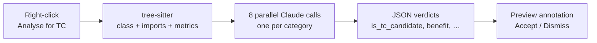

SPRINT 1 PRESENTATION

# Technical Credit Detector

Does an LLM tell design that pays off from code that only looks like a pattern?

  
2.1% flip rate

  
$0.055 per analysis

  
23 / 23 feature checks pass

TechnicalCredit team · Sprint 1 review · 17 Nov 2026

---
layout: divider
part: 1
minutes: 2 min
---

# Project goal

What Technical Credit is, and what the detector does

---

# Technical Credit: the opposite of technical debt

Design decisions that cost a little now and **pay off later**, documented where the code lives.

  

    
<tabler-bulb class="icon" /> The idea

    
Teams record debt, but rarely record the deliberate investments: an interface that lets new vendors plug in, a config point that avoids a redeploy.

    
The detector proposes an <code>@TechnicalCredit</code> annotation with the <b>benefit</b>, the <b>conditions</b> under which it materialises, and the <b>signals</b> seen in the code.

  

  

    
<tabler-category class="icon" /> 8 TC categories

    

      abstractionapi-stability
      automationcompliance-readiness
      configurabilitymodularity
      observabilityreusability
    

    
Each category has its own heuristic prompt.

  

<b>Sprint 1 goal:</b> make the existing VS Code extension safe to use, then <b>measure</b> how accurate, stable, fast and cheap it is. No prompt changes this sprint.

---

# How a class is judged

  

<tabler-cpu class="icon c-blue" /> Model

<code>claude-sonnet-4-6</code>, temperature 0 by default

  

<tabler-link class="icon c-purple" /> ADR linking

Markdown ADRs under <code>docs/</code> are matched and linked as <code>adr = "ADR-0001"</code>

  

<tabler-file-code class="icon c-green" /> Output

Accepted annotations generate a <code>TechnicalCredit.java</code> annotation type

---
layout: divider
part: 2
minutes: 5 min
---

# What we built

Build and Claude config, then a safe annotation lifecycle

---

# Build and Claude configuration

  

    
<tabler-key class="icon" /> API key in SecretStorage

    
New commands <b>Set API Key</b> and <b>Clear API Key</b>. Masked prompt; stored in VS Code SecretStorage instead of a shell variable.

  

  

    
<tabler-adjustments class="icon" /> Model and temperature

    
Settings <code>technicalcredit.model</code> / <code>.temperature</code>, overridden by <code>TC_MODEL</code> / <code>TC_TEMPERATURE</code>. Defaults: <code>claude-sonnet-4-6</code>, <code>0</code>.

  

  

    
<tabler-alert-triangle class="icon" /> Typed error kinds

    

      missing-keyauthtimeoutnetworkrate-limitmodelbad-requestbad-responseconfig
    

    
Each maps to a message written for the user, not raw SDK text.

  

  

    
<tabler-package class="icon" /> <code>.vsix</code> packaging

    
<code>npm run vsix</code> builds an installable package. Only 9 runtime files ship; the pilot study data is excluded.

  

The runner logs requested and returned model, temperature, tokens and latency for every call, so cost is <b>measured</b>, not estimated.

---

# Annotation lifecycle: 7 fixes

| Before (baseline run: 10 pass, 7 fail) | After (retest: all pass) |
| --- | --- |
| Dismiss after an edit deleted the wrong lines; a new analysis deleted real code | Ranges track edits; stale previews are dropped, never deleted blind |
| Accepted annotations broke <code>javac</code> | Valid Java: <code>javac -Xlint:all</code> passes |
| Re-analysis echoed and duplicated annotations | Already-accepted categories are skipped |
| Undo left orphan CodeLenses and highlights | Text, CodeLenses and highlights undo together |
| Enums and records rejected with a misleading message | Enums and records are analysed |
| Pending previews became "accepted" after reload or close | Previews persist in workspace state and are re-verified |
| Activated on <code>*</code> in every workspace | <code>onLanguage:java</code> |

Source: vscode-feature-test-report.md, original run on 9e95f85, retest on cf6cf0c

---
class: wide
---

# Accepted annotations now compile

  <figure class="fig">
    
<tabler-x class="icon" /> Before: <code>key: 'value'</code> pairs, <code>javac</code> errors

    
  </figure>
  

    <figure class="fig">
      
<tabler-check class="icon" /> After: Java annotation syntax, <code>JAVAC_OK</code>

      
    </figure>
    
Accepted annotations in 3 files, plus the generated <code>TechnicalCredit.java</code>, compile with <code>javac -Xlint:all</code>.

  

---

# Regression retest: everything passes

  

17 / 17

original feature tests

  

6 / 6

additional checks

  

3

new bugs found, all fixed

  

    
Found and fixed during the retest

    <ul class="small">
      <li><b class="c-red">High:</b> pending previews silently became "accepted" after a reload (<code>c7dc1ae</code>)</li>
      <li><b class="c-orange">Medium:</b> the <code>.vsix</code> shipped the pilot study data (<code>889023d</code>)</li>
      <li><b>Low:</b> "No TC detected" now names the enum or record (<code>cf6cf0c</code>)</li>
    </ul>
  

  

    
Gate before every push

    tsc:checklint:checkformat:check70 offline Jest tests
    
Clean VS Code 1.146 profile, installed from the <code>.vsix</code>; 10 live analyses, 98 Claude calls.

  

---
layout: divider
part: 3
minutes: 4 min
---

# Pilot study design

Twin items, three label dimensions, a runner and pre-registered hypotheses

---

# Twin items: credit vs. look-alike

Each GoF pattern written twice: once where it **pays off**, once where it only **looks** like it does.

| Pair | Credit twin (primary category) | No-credit twin |
| --- | --- | --- |
| **Strategy** | `QuoteService` picks an injected `RateRule` from a property configurability | Same shape, one `RateRule` built inline, no config |
| **Adapter** | `EmailNotifier` implements a domain `Notifier` over a vendor client abstraction | `EmailSender` forwards vendor calls one-for-one |
| **Observer** | `StockLevels` with runtime subscribe / unsubscribe modularity | Same shape, one listener hard-wired with `new` |

  

<tabler-eye-off class="icon c-orange" /> No leaks

No comments, neutral package <code>app</code>, no <code>Strategy</code>/<code>Adapter</code> suffixes

  

<tabler-ruler class="icon c-orange" /> Size-matched

Twins within 30% line count, checked by a unit test

  

<tabler-shape class="icon c-orange" /> Same structure

2 of 3 look-alikes keep interface + implementation

---

# Labels, runner and metrics

  

    
<tabler-tags class="icon" /> Three label sets

    <ol class="small">
      <li><b><code>tc</code></b>: item-level yes / no</li>
      <li><b><code>categories</code></b>: yes / no / unsure for all 8</li>
      <li><b><code>designPatterns</code></b>: GoF roles, matching upstream PR #145</li>
    </ol>
  

  

    
<tabler-player-play class="icon" /> Runner

    
<code>npm run pilot -- run</code> reuses the production path.

    
<b>6 items × 5 repeats × 8 heuristics = 240 calls</b>, written to <code>calls.jsonl</code> with tokens and latency.

  

  

    
<tabler-chart-dots class="icon" /> Metrics

    
Unit: (item, category) pair, 6 × 8 = 48. Majority vote over repeats.

    
Flip rate · pooled P/R/F1 · item accuracy · twin discrimination · cost · latency

  

  
<tabler-scale class="icon" /> Baselines

  
Always-yes / always-no, and a <b>pattern-presence oracle</b>: a perfect "is there a GoF pattern here?" check. Beating it means the detector sees <i>credit</i>, not just patterns.

---

# Pre-registered hypotheses

Committed before the first billed run; thresholds evaluated mechanically.

| ID | Hypothesis | Tests |
| --- | --- | --- |
| **H1** | Flip rate below 5% of (item, category) pairs | Stability |
| **H2** | Primary category fires on at least 2 of 3 credit twins | Recall on the intended credit |
| **H3** | In at least 2 of 3 pairs, primary fires on the credit twin and not on its look-alike | Twin contrast |
| **H4** | Pooled F1 beats always-yes **and** accuracy beats always-no | Better than trivial |
| **H5** | Item-level accuracy beats the pattern-presence oracle | Credit, not pattern |
| **H6** | p95 latency per analysis below 10 s | Usability |

---
layout: divider
part: 4
minutes: 6 min
---

# Results

`claude-sonnet-4-6`, temperature 0, commit `5fedccc`, 240 calls, 0 errors

---

# Headline numbers

  

2.1%

flip rate 1 of 48 pairs · target &lt; 5%

  

4 / 6

items classified right pattern oracle also 4 / 6

  

7.6 / 9.1 s

latency p50 / p95 target p95 &lt; 10 s

  

$0.055

per analysis (8 calls) $1.66 for the whole run

  

    
Pooled pair-level F1

    <Bar label="Detector" :value="26.7" color="var(--orange)" />
    <Bar label="Always yes" :value="19.6" color="var(--muted)" />
    
Beats always-yes

  

  

    
Pooled pair-level accuracy

    <Bar label="Detector" :value="76.1" color="var(--orange)" />
    <Bar label="Always no" :value="89.1" color="var(--muted)" />
    
Loses to always-no, so H4 fails

  

---

# Hypotheses: 4 pass, 2 fail

  
<b>H1</b> Stability2.1% flips

  
<b>H2</b> Primary fires2 of 3 credit twins

  
<b>H3</b> Twins told apart2 of 3 pairs

  
<b>H4</b> Beats trivial baselinesF1 yes, accuracy no

  
<b>H5</b> Beats pattern oracle4 / 6 vs 4 / 6

  
<b>H6</b> p95 &lt; 10 s9.1 s (borderline)

  
<tabler-bulb class="icon" /> Bottom line

  
Stable and cheap, but it doesn't yet tell real credit apart from code that merely <b>looks</b> like a pattern. The two hypotheses that test usefulness fail.

Replication run (same code): same scores, except 0% flips and p95 10.1 s, which fails H6 by 0.1 s.

---

# Why: look-alikes fool it, and two prompts drive the errors

  

    
<tabler-mask class="icon" /> Look-alikes

    
The one-implementation strategy and the hard-wired observer are flagged as TC on <b>every</b> repeat. The plain forwarder is correctly ignored.

    
The signal is closer to "uses interfaces" than "this design pays off".

  

  

    
<tabler-circle-off class="icon" /> <code>abstraction</code> never fires

    
Its checklist leans on name suffixes and interfaces that aren't in the snippet; only the anchor class is sent.

  

  

    
<tabler-flame class="icon" /> <code>api-stability</code> over-fires

    
Fires on 5 of 6 items, all false positives. A loose bullet list with no decision rule.

  

Exploratory: credit twins draw more firing categories than look-alikes (2.5 vs 1.0 per analysis). A count threshold might separate them; to be tested.

---

# Key finding: the reported category is overwritten

When a call fires, the model often names a **different** category. `analyseForTC` replaces it with the one asked.

  

| Heuristic asked | Fired | Category the model reported |
| --- | --- | --- |
| `api-stability` | 48 | abstraction 38, configurability 10 |
| `automation` | 10 | configurability 10 |
| `reusability` | 10 | configurability 10 |
| `configurability` | 10 | configurability 10 |
| `modularity` | 30 | modularity 30 |

Both runs combined. 62.3% of fired answers name another category (reference run).

  

  

    

      
Score by the reported category

      <Bar label="F1" :value="67" :from="26.7" color="var(--green)" />
      <Bar label="Accuracy" :value="91.3" :from="76.1" color="var(--green)" />
      
Accuracy now beats always-no (89.1%) in both runs.

    

    
exploratory · chosen after seeing the data

  

---
class: wide
---

# In VS Code: previews on a real interface

  <figure class="fig col-span-3">
    
    Shapes.java: 2 previews above <code>interface Shape</code>, each with Accept / Dismiss
  </figure>
  

    <figure class="fig">
      
      ADR linking: <code>adr = "ADR-0001"</code>
    </figure>
    <figure class="fig">
      
      No key: an actionable message with a Set API Key button
    </figure>
  

---

# In VS Code: records and real-world code

  <figure class="fig">
    
    The <code>Money</code> record gets 3 previews; records were rejected before Sprint 1
  </figure>
  <figure class="fig">
    
    iluwatar Observer sample: <code>modularity</code> and <code>abstraction</code> credit on <code>Weather</code> (earlier build, before the syntax fix)
  </figure>

---
layout: divider
part: 5
minutes: 3 min
---

# Limitations and Sprint 2

What the numbers can't tell us yet, and what we do next

---

# Limitations

  

<tabler-users class="icon c-red" /> One labeller

The study author built the items and wrote every label. No agreement figure yet.

  

<tabler-chart-dots-3 class="icon c-red" /> Small sample

6 synthetic items, 46 scored pairs. Results are indicative, not estimates.

  

<tabler-eye-question class="icon c-red" /> Unobservable recall

5 categories have no positive item; only their false positives can be seen.

  

<tabler-flask class="icon c-red" /> Exploratory re-scoring

The 67% F1 by reported category was chosen after seeing the data.

Also: temperature 0 only, synthetic code, and the taxonomy is about to change upstream (PR #145).

---

# Sprint 2 next steps

  

    
<tabler-user-check class="icon" /> 1 · Second labeller

    
An independent person labels the 6 items blind; report agreement (Cohen's κ) on <code>tc</code> and per category. Needs a human.

  

  

    
<tabler-git-pull-request class="icon" /> 2 · Rerun on GoF categories

    
Re-run the pilot on upstream <a href="https://github.com/cielbellerose/TechnicalCredit/pull/145">cielbellerose/TechnicalCredit#145</a> ("category → design pattern" output). The harness supports it unchanged at item level.

  

  

    
<tabler-arrows-split class="icon" /> 3 · Category decision

    
Keep the model's reported category, or ask once for all categories (1 call instead of 8). Same checklist + decision rule for every prompt, no name-based evidence, a "does it pay off?" test.

  

  

    
<tabler-temperature class="icon" /> 4 · Temperature 1 run

    
<code>TC_TEMPERATURE=1 npm run pilot -- run</code>, about $1.70, to see how much stability depends on temperature 0. Log per-call reasoning first.

  

Pilot spend so far: $3.40 of an $11 budget (smoke test + two full runs).

---
layout: center
class: text-center
---

# Questions?

Results: <code>study/sprint-1-results.md</code> · Pre-registration: <code>study/README.md</code>

SASUKE40/technicalcredit

